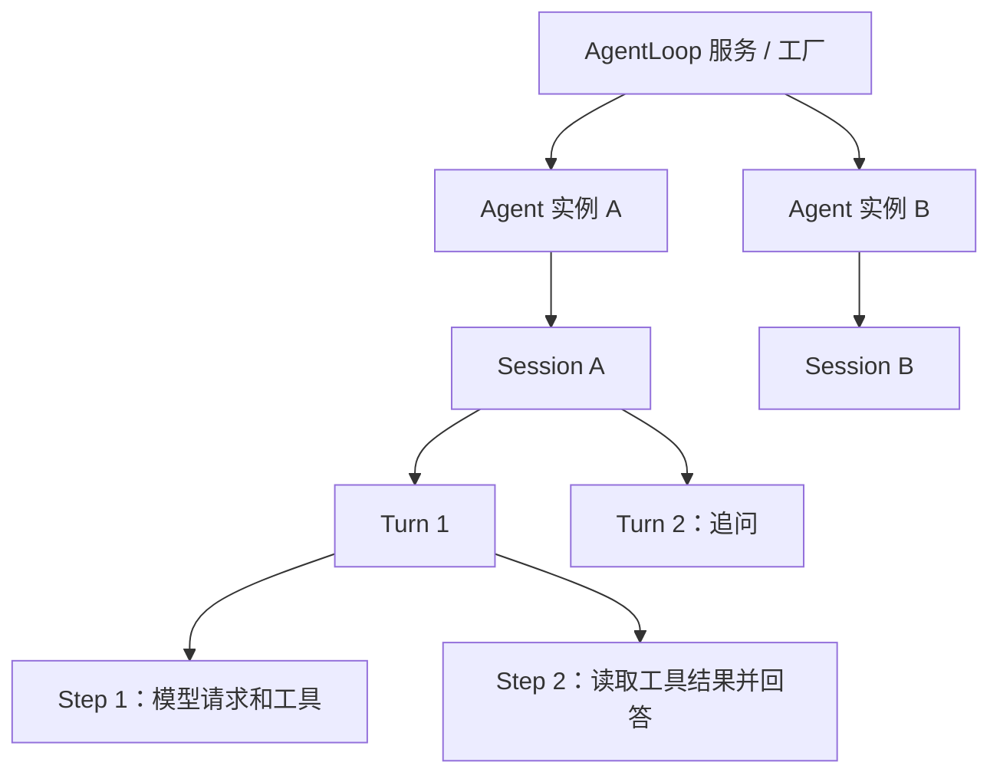

# core/agent-loop（@deepseek-ai/dsh-agent-loop）

## 概要

`packages/core/agent-loop` 实现默认的 Agent 驱动器：创建或恢复会话，为每个 Agent 建立独立作用域，领取输入，调用模型，执行工具，并把后续请求需要的事实写入会话日志。阅读本专题后，可以沿一次提问找到它对应的创建事务、轮次、模型请求和结束记录。

本专题是当前源码的中文阅读笔记。`core/agent` 定义公开接口和注册表；本包提供具体工厂和驱动实现。公开 API 的完整说明见 [core/agent wiki](../core-agent/README.md)，部署配置见 [包 README](../../packages/core/agent-loop/README.zh.md)。

## 阅读顺序

| 页面 | 主要问题 |
|---|---|
| [01 创建与生命周期](01-creation-and-lifecycle.md) | 服务挂载后做什么？create、resume、setup、发布和 dispose 如何衔接？ |
| [02 轮次与收件箱](02-turns-and-inbox.md) | followup、steer、inject 如何进入 Turn 和 Step？什么时候算 idle？ |
| [03 模型请求与日志](03-model-requests.md) | 提示词、动态上下文和工具声明何时写入日志？重试和流式输出如何记录？ |
| [04 工具、取消与恢复](04-tools-and-recovery.md) | 工具如何并行且保序？取消、失败和进程重启分别留下什么？ |
| [05 源码与测试索引](05-source-map.md) | 阅读哪个文件或测试，可以进一步核对某项行为？ |

## 运行时对象关系

**一个 Agent 实例固定绑定一个 Session；一个 AgentLoop 服务可以创建多个这样的实例。** `ReactLoopAgent` 构造函数接收 `readonly id` 和 `readonly session`，驱动期间始终使用这份 Session。注册表还检查 `agent.id === agent.session.id`。



这里的包含关系表示日志中的执行记录。Turn 和 Step 不是各自持有独立 Session 的 Agent 对象。

| 概念 | 在本实现中的含义 |
|---|---|
| Agent preset | 可以复用的插件与能力组合；多个 Agent 可以选择同一个预设 |
| `AgentLoop` | Cordis 服务 `ctx.agentLoop`；注册工厂、持有配置并管理所创建实例的生命周期 |
| `ReactLoopAgent` | 一个活跃 Agent 的具体实现；持有 Session、作用域、收件箱和执行状态 |
| Session | 追加式事件日志，以及从日志派生的模型历史和状态 |
| Turn | 一次领取输入后的执行区间；可以没有 Step，也可以连续执行多个 Step |
| Step | 一个被接纳的步骤；通常包含一次模型调用和它的工具执行，失败重试可以产生多次调用尝试 |

同一聊天里的追问通常增加 Turn，不会换 Session。创建子 Agent 或 fork 则产生另一个 Session。关闭 Agent 后，持久化日志可以保留；`resume()` 在同一个会话身份上重建新的 Agent 对象和作用域。

## 一次输入的整体路径

```text
ctx.agents.create / resume
  → AgentLoop 构造 ReactLoopAgent，并发布 Agent 与 Session
  → agent.followup(message)
  → 收件箱记录待处理输入，唤醒驱动器
  → turn/start
  → 领取输入、组装提示词和工具、agent/pre-step
  → step/start
  → agent/request、prepareCall、接纳输入并构造日志派生请求
  → 模型流式输出，结算 assistant/message 或 assistant/attempt
  → 如有工具调用：调度工具并记录结果
  → step/end
  → 继续当前 Turn 的下一 Step，或执行 agent/turn-stopping
  → turn/end
  → 处理下一个排队 Turn，或回到 idle
```

`agent/*` 事件用于实时观察和扩展，Session 事件用于恢复和重建。实时 `agent/assistant-stream` chunk 在最终结算前只存在于进程内；模型尝试结算后，紧凑流记录随 `assistant/message` 或 `assistant/attempt` 写入日志。

## 扩展时从哪里接入

消费方通常通过 `ctx.agents` 和 `agent.ctx` 工作。前者提供公开创建与控制接口，后者让工具、提示词段和监听器只对当前 Agent 生效。模型适配器、工具实现、压缩和重试策略由相应服务或事件提供；本包组织这些调用的时序。

例如，`agent/pre-step` 控制消息准入，`agent/request` 修改请求配置，`agent/request-error` 决定是否重试，`agent/turn-stopping` 可以加入 steering 继续当前 Turn。Waterfall 监听器调用 `next()` 才会委托后续监听器；`agent/created` 和 `agent/turn-stopping` 是串行事件，没有 `next()`。

## 分析范围与依据

本专题核对本包全部七个 `src/*.ts` 文件，以及创建、恢复、请求、收件箱、工具和取消相关测试。各页链接到对应源码和测试；测试索引表示已有用例的阅读入口，不表示本次已执行这些测试。

进一步阅读：[架构](../../docs/architecture.zh.md)、[Core 子系统](../../docs/subsystems/core.zh.md)、[Session 子系统](../../docs/subsystems/session.zh.md)、[工具执行管线](../../docs/tool-execution-pipeline.zh.md)。
